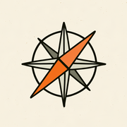
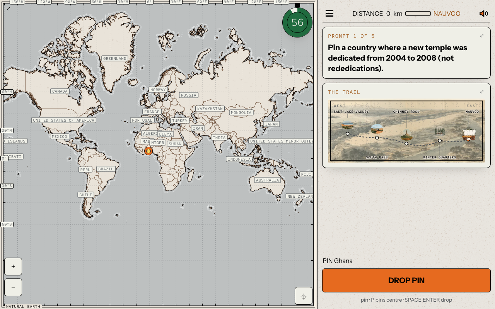
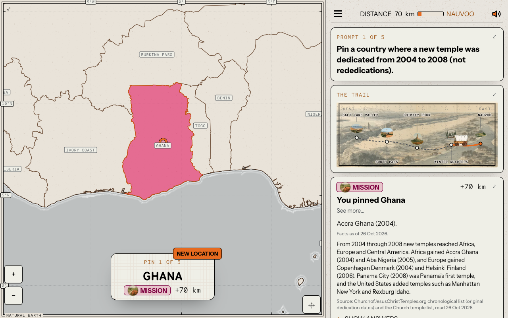
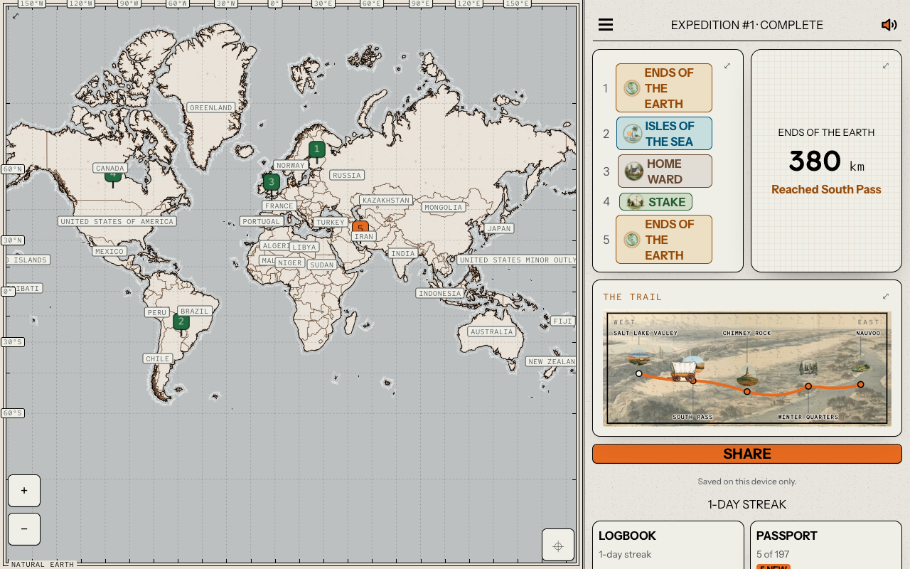
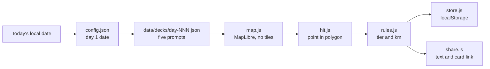

<div align="center">



# Ends of the Earth

**A daily map game of Latter-day Saint history, the scriptures and the lands of the Bible.**

Five prompts a day. Answer each one by pinning a country. The rarer your
correct answer, the further it carries you along the pioneer trail.

**[Play it here](https://bjepp77.github.io/ends-of-the-earth/)** · new expedition at midnight, your time

<sub>MIT licensed · static site · plain JavaScript modules · no accounts · no ads · runs in your browser</sub>

</div>

<br>

<div align="center">
  
</div>

<br>

---

## Why

Most of us know the first answer. This game rewards the next one: the country
you only reach by remembering a mission call, a conference talk, a footnote,
or a map in the back of your scriptures.

It is a quiz that scores *insight*, not recall. Most prompts have several
right answers. The obvious one moves you 40 km. The one few players would
think of moves you 100.

## How to play

1. Press **Play daily expedition**. The first prompt appears and a 60 second clock starts.
2. Tap a country to place your pin. Press **Drop pin** to lock it in.
3. Read the note on the answer, with its source, then go on.
4. After five pins you reach camp: your total, where you reached on the trail,
   and every answer that would have counted.

Everyone gets the same five prompts on the same day. When the clock runs out,
a pin you have placed is judged as if you dropped it. With no pin, it is a miss.

<div align="center">
  
</div>

## How far an answer takes you

Every country that fits a prompt is sorted by how readily it comes to mind.
Every prompt has at least one answer in the top tier.

| | Tier | Distance |
|:-:|:--|--:|
|  | Ends of the earth | 100 km |
|  | Isles of the sea | 85 km |
|  | Mission | 70 km |
|  | Stake | 55 km |
|  | Home ward | 40 km |
| | Lost sheep (miss) | 0 km |

Turn country names off and every correct answer earns 10% more, rounded to the
nearest km (40 becomes 44, 100 becomes 110). The bonus only counts if names
were off when the prompt opened and still off when the pin is judged.

The day caps at 500 km. Your total places you on the trail west:

| You reach | With at least |
|:--|--:|
| Nauvoo | 0 km |
| Winter Quarters | 100 km |
| Chimney Rock | 250 km |
| South Pass | 350 km |
| Salt Lake Valley | 500 km |

<div align="center">
  
</div>

## Features

- **A new expedition every day**, with a streak, a logbook of past days, a
  passport of the 197 sovereign countries, sorted by continent, and 39
  souvenirs to earn at camp.
- **Past week** keeps the last seven days open. Late days are logged but do
  not keep a streak alive.
- **Difficulty options.** Turn country names off for the 10% bonus, turn
  borders off, or use a 30 second clock. Each is marked on your shared result.
- **Share** your day as two lines of text and a link. Each link opens a
  ready-made preview card for that exact result, so a chat app shows a picture.
- **Practice round** with no clock, as often as you like.
- **Question 6**, a bonus Book of Mormon map question at camp on some days.
  It is unscored and touches nothing else in the game. The map is a drawing
  of the geography the text describes and makes no claim about real-world locations.
- **Sourced answers.** Facts come from the scriptures, *Saints* (the Church's
  four-volume history), Church News and other published sources. Each answer
  shows its source. Facts that change are stated as of 26 October 2026.
- **Works on a phone.** Close taps zoom in so you can pick small countries.
  Save it to your home screen and it opens like an app.
- **Full keyboard play** on desktop: arrow keys pan, `P` pins the centre,
  Space or Enter drops.
- Guide, rulings, blog, about and changelog pages ship with the game.

## How it's built



- The whole game is static files: 17 JavaScript modules (about 4,100 lines),
  two stylesheets and JSON data. There is no server, no framework and no
  build step in this repo.
- The map is drawn by MapLibre GL JS from a single `data/countries.json`
  (Natural Earth shapes). No map tiles are fetched.
- `hit.js` decides which country a pin is in with its own point-in-polygon
  test. A pin at sea or in a disputed area cannot be dropped. Territories
  count for the country they belong to.
- `rules.js` holds the scoring, the trail, the dates and the share text as
  pure functions with no DOM access.
- Progress lives only in this browser's `localStorage`.
- `s/` holds 7,776 premade share pages and images, one for every possible
  run of five tiers (6 x 6 x 6 x 6 x 6). A shared link points at one of them,
  so link previews work with no server.
- Script and style URLs carry a `?v=` hash, so a new build is never mixed
  with a cached old one.

## Privacy

- No accounts, no cookies, no ads.
- Expeditions, stamps, souvenirs and settings are saved on your device only.
  Clearing browser data clears your game.
- The game sends anonymous counts to [GoatCounter](https://www.goatcounter.com/)
  through `count.js`: page visits, started and finished expeditions, and
  shares. Each count is a plain image request carrying the page path or event
  name, and for a visit from another site, that site's origin only (no path,
  no query). No cookies, no IDs, nothing stored on your device, and no
  third-party script runs.
- Counting is off on `localhost`.

## Development

The game uses ES modules, so it needs a web server, not a `file://` open.

```bash
git clone https://github.com/Bjepp77/ends-of-the-earth.git
cd ends-of-the-earth
python3 -m http.server 8000
```

Then open http://localhost:8000/.

```
index.html   the game page         app.js     game flow, screens, timer
map.js       MapLibre map, pins    hit.js     point-in-polygon country test
rules.js     scoring, trail, dates store.js   localStorage
share.js     share sheet or copy   count.js   anonymous GoatCounter counts
menu.js      menu drawer             panels.js  logbook, passport, past week, souvenirs
q6.js        Question 6            data/      decks, countries, souvenirs, Question 6
s/           premade share cards   vendor/    MapLibre GL JS
```

This repo holds the built site only. The source, data tools and tests live
in a private repo, and a tested build is copied here to publish.

## Status and limits

- **Live.** Day 1 was 27 October 2026. The decks are finite: 48 days are written,
  and after the last one the game says which expedition was the last dealt.
- The map has no Antarctica. Borders follow the United Nations view.

## Credits

An independent project. It is not made, endorsed or reviewed by The Church of
Jesus Christ of Latter-day Saints.

Third-party assets keep their own licenses:

- Country shapes: [Natural Earth](https://www.naturalearthdata.com/), public domain.
- Map rendering: MapLibre GL JS, BSD 3-Clause ([`vendor/maplibre/LICENSE.txt`](vendor/maplibre/LICENSE.txt)).
- Fonts: National Park, Instrument Sans and Red Hat Mono, SIL Open Font License 1.1
  ([`fonts/`](fonts/), one `*-OFL.txt` per family).
- The look follows the Furrow theme from Hallmark (MIT), adapted by hand.
- The lost sheep's bleat: ["Sheep bleating"](https://commons.wikimedia.org/wiki/File:Sheep_bleating.ogg)
  by earthcalling, public domain, from Wikimedia Commons, cut to one second.

## License

The code is [MIT](LICENSE). The MIT license does not cover the third-party
assets above, the illustrations, or the written prompts and answer notes.
