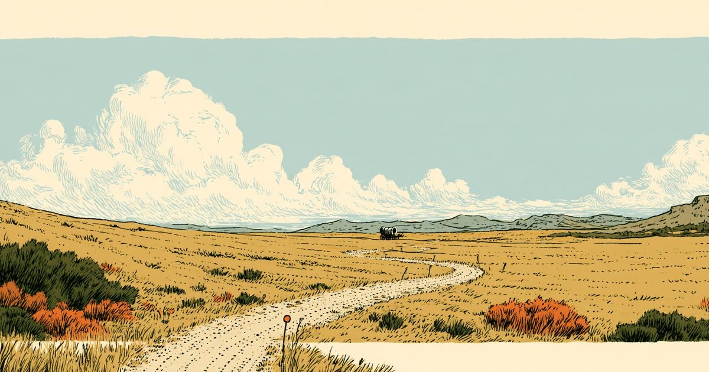
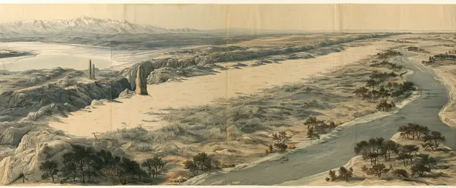
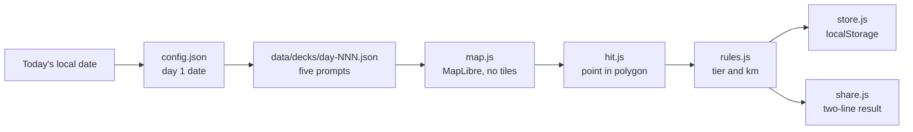

<div align="center">


# Ends of the Earth

**A daily map game of Latter-day Saint history, the scriptures and the lands of the Bible.**

Five prompts a day. Answer each one by pinning a country. The rarer your
correct answer, the further it carries you along the pioneer trail.

**[Play it here](https://bjepp77.github.io/ends-of-the-earth/)** · new expedition at midnight, your time

<sub>Static site · plain JavaScript modules · no accounts · no ads · runs in your browser</sub>

</div>

<br>

<div align="center">
  
</div>

<br>

---

## Why

Most of us know the first answer. This game rewards the next one: the country
you only reach by remembering a mission call, a conference talk, a footnote,
or a map in the back of your scriptures.

It is a quiz that scores *insight*, not recall. Most prompts have several
right answers. The obvious one moves you 40 km. The one few players would
think of moves you 100.

## How to play

1. Press **Play daily expedition**. The first prompt appears and a 60 second clock starts.
2. Tap a country to place your pin. Press **Drop pin** to lock it in.
3. Read the note on the answer, with its source, then go on.
4. After five pins you reach camp: your total, where you reached on the trail,
   and every answer that would have counted.

Everyone gets the same five prompts on the same day.

### How far an answer takes you

Every country that fits a prompt is sorted by how readily it comes to mind.
Every prompt has at least one answer in the top tier.

| | Tier | Distance |
|:-:|:--|--:|
|  | Ends of the earth | 100 km |
|  | Isles of the sea | 85 km |
|  | Mission | 70 km |
|  | Stake | 55 km |
|  | Home ward | 40 km |
| | Lost sheep (miss) | 0 km |

The day caps at 500 km. Your total places you on the trail west, from Nauvoo
through Winter Quarters, Chimney Rock and South Pass to the Salt Lake Valley.

<div align="center">
  
</div>

## Features

- **A new expedition every day**, with a streak, a logbook of past days, a
  passport of countries collected at each tier, and souvenirs from camp.
- **Past week** keeps the last seven days open. Late days are logged but do
  not keep a streak alive.
- **Difficulty options.** Turn country names off for a 10% distance bonus,
  turn borders off, or use a 30 second clock. Each is marked on your shared result.
- **Share** your day as two lines of text.
- **Practice round** with no clock, as often as you like.
- **Question 6**, a bonus Book of Mormon map question at camp on some days.
  It is unscored. The map is a drawing and makes no location claim.
- **Sourced answers.** Facts come from the scriptures, *Saints* (the Church's
  four-volume history), Church News and other published sources. Each answer
  shows its source. Facts that change are stated as of 26 October 2026.
- **Works on a phone.** Close taps zoom in so you can pick small countries.
  Full keyboard play on desktop.
- Guide, rulings, blog and changelog pages ship with the game.

## How it works



- The whole game is static files. There is no server and no build step in
  this repo.
- The map is drawn by MapLibre GL JS from a single `data/countries.json`
  (Natural Earth shapes). No map tiles are fetched.
- `hit.js` decides which country a pin is in with its own point-in-polygon
  test. A pin at sea or in a disputed area cannot be dropped. Territories
  count for the country they belong to.
- `rules.js` holds the scoring as pure functions with no DOM access.
- Progress lives only in this browser's `localStorage`.

## Run it locally

The game uses ES modules, so it needs a web server, not a `file://` open.

```bash
git clone https://github.com/Bjepp77/ends-of-the-earth.git
cd ends-of-the-earth
python3 -m http.server 8000
```

Then open http://localhost:8000/. The anonymous counter is off on localhost.

## Privacy

- No accounts, no cookies, no ads.
- Expeditions, stamps, souvenirs and settings are saved on your device only.
  Clearing browser data clears your game.
- The only thing sent is an anonymous count of visits, started and finished
  games, and shares to
  [GoatCounter](https://www.goatcounter.com/), by a plain image request. No
  third-party script runs. See `count.js`.

## Tech stack

Vanilla JavaScript (ES modules), HTML and CSS. MapLibre GL JS, vendored in
`vendor/maplibre/`. Natural Earth country shapes. Fonts are National Park,
Instrument Sans and Red Hat Mono, served from `fonts/`. Hosted on GitHub Pages.

## Status and limits

- **Live.** Day 1 was 27 October 2026. The decks are finite: 48 days are written,
  and after the last one the game says which expedition was the last dealt.
- This repo holds the built site only. The source, data tools and tests live
  in a private repo, and a tested build is copied here to publish.
- The map has no Antarctica. Borders follow the United Nations view.

## Credits and license

An independent project. It is not made, endorsed or reviewed by The Church of
Jesus Christ of Latter-day Saints.

- Country shapes: [Natural Earth](https://www.naturalearthdata.com/), public domain.
- Map rendering: MapLibre GL JS, BSD 3-Clause (`vendor/maplibre/LICENSE.txt`).
- Fonts: SIL Open Font License 1.1 (`fonts/*-OFL.txt`).
- The lost sheep's bleat: "Sheep bleating" by earthcalling, public domain,
  from Wikimedia Commons.

The game's own code and content have no license file, so default copyright applies.
